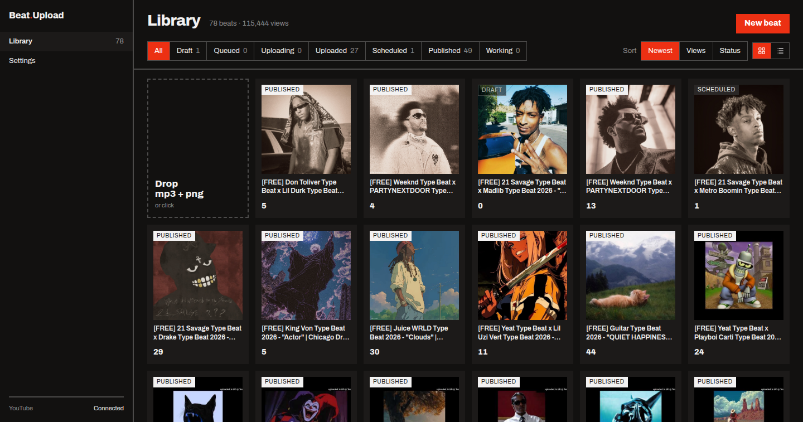

# Beat Upload

Turns a beat (audio + cover) into a 1080p video, uploads it to YouTube and tracks how it performs.



## Install

```bash
python3 -m venv .venv && source .venv/bin/activate
pip install -e .
beat-upload serve --open-browser     # http://127.0.0.1:8765
```

Needs Python 3.13, `ffmpeg` on PATH and a Google Cloud OAuth client with the YouTube Data
and Analytics APIs enabled. Connect the channel on the Settings page.

## What it does

- Paste the path of a Bounce Folder (WAV, tagged MP3, cover, stems; BPM, key and moods in its name): a Draft appears and the render starts while you write the metadata. Nothing is copied.
- Title, description and tags come prefilled from your templates, with a YouTube-style preview.
- "Save & upload when rendered" queues the upload; it runs by itself once the video is ready.
- Publish now, or schedule a time and YouTube makes it public then, even with the laptop closed.
- Change the privacy of anything already on the channel, the way YouTube Studio does it.
- Imports every video the channel had before the app and shows views per beat.
- Pulls daily views and watch time from the Analytics API every night and charts them per beat.
- Runs as a user systemd service, so it survives reboots.

The CLI does the same without the UI: `login`, `upload`, `videos`, `analytics`, `privacy`.

## BeatStars

BeatStars has no API, so the CLI fills the Studio form in a real browser (Playwright):

```bash
pip install -e '.[beatstars]' && playwright install chromium
beat-upload beatstars prepare ~/bounces/Diavolo --youtube-id -3aBT57ZdEo
beat-upload beatstars upload ~/bounces/Diavolo/beatstars   # --no-publish leaves a draft
```

The bounce folder holds `NAME_95bpm_Cmin_dark-intense_delawer.wav` (untagged master),
`NAME_95bpm_Cmin_dark-intense_delawer_tagged.wav` or `.mp3`, a cover and optionally the
beat's `config.yaml`. The parts are name, tempo, key, moods (optional, joined with `-`),
`smp` when there are foreign samples, `delawer`. `prepare` cuts the leading silence of both
bounces at the same bar, encodes a 320k tagged MP3, squares the cover and writes
`beatstars.json` (title, description, 3 tags, genres, moods, instruments), built from the
YouTube title in `config.yaml`. Moods, instruments and genres must be spelled as Studio lists
them (`beat_upload/beatstars/catalog.py`). Edit the json, then `upload`. `--release-at
2026-10-12T15:00` (local time) schedules the track instead of publishing it now. Studio
creates the track at the first file; the command prints its `TK` id at once, and a failure
afterwards says `finish it with --draft TK...`. The first run opens Studio for you to sign in;
the session stays in the workspace. The window has the class `beat-upload-beatstars`, so a
window manager rule can keep it on another desktop.

### From the web app

A Draft made from a Bounce Folder that is sent public, or scheduled, goes onto BeatStars
first and onto YouTube after: "Save & upload when rendered" queues a BeatStars Job next to
the Render, the Upload waits for both, and the Track is released when the video is (now, or
at the scheduled time). A private or unlisted send skips BeatStars. If Studio fails, the
beat stays Queued with the error on the Job; Retry continues the same Studio draft, or "Upload without BeatStars" sends the video with
the fallback line in the description.

A beat that went to YouTube without a Track (sent private and published since, or sent
without BeatStars) has "Put on BeatStars" on its page once it is Published or Scheduled. It
runs the same Job, released now or at the publish time, and then updates the YouTube
description so the marker becomes the link (`videos.update`, 50 quota units).

One edit to your description Template, once: put the marker where the link should go, with
the text for beats without a Track after the `|`:

```
{beatstars|DM @delawer33 on Instagram}
```

At upload it becomes the Track's URL, or that text when the beat has none. Fill from title
leaves it alone. The Studio window is a real browser, so the service needs your display: run
`systemctl --user import-environment WAYLAND_DISPLAY` from your compositor's autostart (the
unit from `install-service` passes it on), then restart the service. The window opens on the
workspace your window manager rule gives the class `beat-upload-beatstars`.

## How it works

One Python package with no web or database code renders the video with ffmpeg and talks
to YouTube. A FastAPI server on top keeps a SQLite library, a job queue and a scheduler, and
serves the React frontend. A video is never re-rendered; the status of a Beat is what you did
with it, a Job is what is happening right now.

Full guide: [docs/guide.md](docs/guide.md). Why it is built this way: [docs/adr](docs/adr).
Vocabulary: [CONTEXT.md](CONTEXT.md).

## Status

In daily use on one channel. Instagram is in the repo name and nowhere else.
